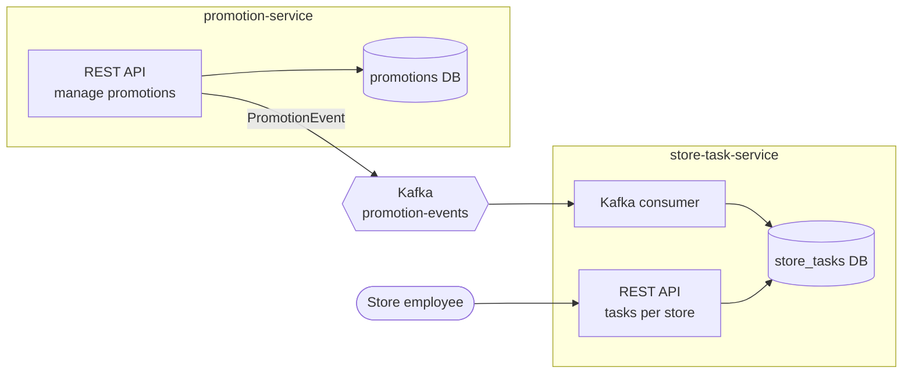

# store-ops

[](https://github.com/MLeona020839/store-ops/actions/workflows/ci.yml)

> TODO: one sentence on what this does, e.g. *Event-driven microservices that turn weekly
> supermarket promotions into shelf-label tasks for store employees.*

## The problem

<!-- TODO: 3–5 sentences in your own words. Who is the user (a store employee),
what goes wrong today (labels changed late, missed products, paper lists),
and what this system does about it. -->

## Architecture



| Module | Responsibility | Port |
|---|---|---|
| `events` | Shared event contracts (`PromotionEvent`), no framework dependencies | – |
| `promotion-service` | Stores promotions and publishes an event when one is scheduled or cancelled | 8081 |
| `store-task-service` | Consumes promotion events and turns them into label-change tasks per store | 8082 |

Each service owns its own database; they communicate only through Kafka.

## Tech stack

Kotlin 2.3 · Spring Boot 4 · Spring Data JDBC · Flyway · PostgreSQL 18 · Apache Kafka 4 (KRaft) ·
JUnit 5 · Testcontainers · ktlint · GitHub Actions

## Running locally

Requirements: JDK 21 and Docker.

```bash
docker compose up -d                          # PostgreSQL + Kafka
./gradlew :promotion-service:bootRun          # http://localhost:8081
./gradlew :store-task-service:bootRun         # http://localhost:8082
```

Health checks: `curl localhost:8081/actuator/health`

Alternatively, run `TestPromotionServiceApplication` / `TestStoreTaskServiceApplication`
from your IDE: they start the service against throwaway Testcontainers, no compose needed.

## API

`promotion-service`:

| Method | Path | |
|---|---|---|
| `POST` | `/promotions` | Create a promotion; `201` with a `Location` header |
| `GET` | `/promotions/{id}` | One promotion |
| `GET` | `/promotions?from=2026-11-16` | Running on that day or starting later, soonest first; `from` defaults to today (Europe/Amsterdam) |
| `POST` | `/promotions/{id}/cancel` | Cancel; idempotent |

```bash
curl -i localhost:8081/promotions -H 'Content-Type: application/json' -d '{
  "title": "Alle kipfilet", "label": "25% korting", "kind": "PERCENT_OFF", "percent": 25,
  "validFrom": "2026-11-16", "validUntil": "2026-11-22",
  "storeIds": ["store-1001", "store-1002"], "productIds": ["product-42"]
}'
```

Errors are [RFC 9457](https://www.rfc-editor.org/rfc/rfc9457) problem details (`application/problem+json`):
`400` for invalid input or a broken business rule (with the reason in `detail`), `404` for an unknown id,
`409` when the promotion was changed concurrently.

## Testing

```bash
./gradlew build        # ktlint + unit tests + integration tests
./gradlew ktlintFormat # auto-fix formatting
```

Integration tests use Testcontainers with real Kafka and PostgreSQL. They are skipped
automatically when Docker isn't available and always run in CI.

## Design decisions

<!-- TODO: this section is what interviewers read most closely. For each decision:
what you chose, what you considered instead, and why. Candidates as you build them: -->

- **Database per service** – <!-- why not one shared database? -->
- **Spring Data JDBC instead of JPA** – <!-- immutable Kotlin data classes, no lazy loading surprises -->
- **Idempotent consumer** – <!-- Kafka is at-least-once; how do duplicates get ignored? (eventId) -->
- **Transactional outbox** – <!-- what goes wrong if you save to the DB and then publish to Kafka? -->
- **Dead-letter topic** – <!-- what happens to an event that can never be processed? -->

## How I used AI tools

<!-- TODO: be specific and honest; this is a skill the role asks for. For example:
- What I used Claude Code for (scaffolding, test cases, reviewing my Kafka config, ...)
- Where it was wrong or overconfident, and how I caught it (tests, docs, reading the code)
- What I deliberately wrote myself, and why
- How CLAUDE.md keeps it consistent with this project's conventions -->

## Roadmap

- [x] Promotion API: create, get, list, cancel, with validation (`promotion-service`)
- [ ] Update a promotion (`PUT` with optimistic locking through `If-Match`)
- [x] Flyway migration for `promotion-service`
- [ ] Flyway migration for `store-task-service`
- [ ] Publish `PromotionEvent` on schedule / cancel
- [ ] Consume events and create tasks per store (`store-task-service`)
- [ ] Task API: list open tasks for a store, mark a task done
- [ ] Idempotent consumer + dead-letter topic
- [ ] Transactional outbox in `promotion-service`
- [ ] Testcontainers integration test covering the full flow
- [ ] Dockerfiles for both services
- [ ] (Optional) Deploy to Azure Container Apps
